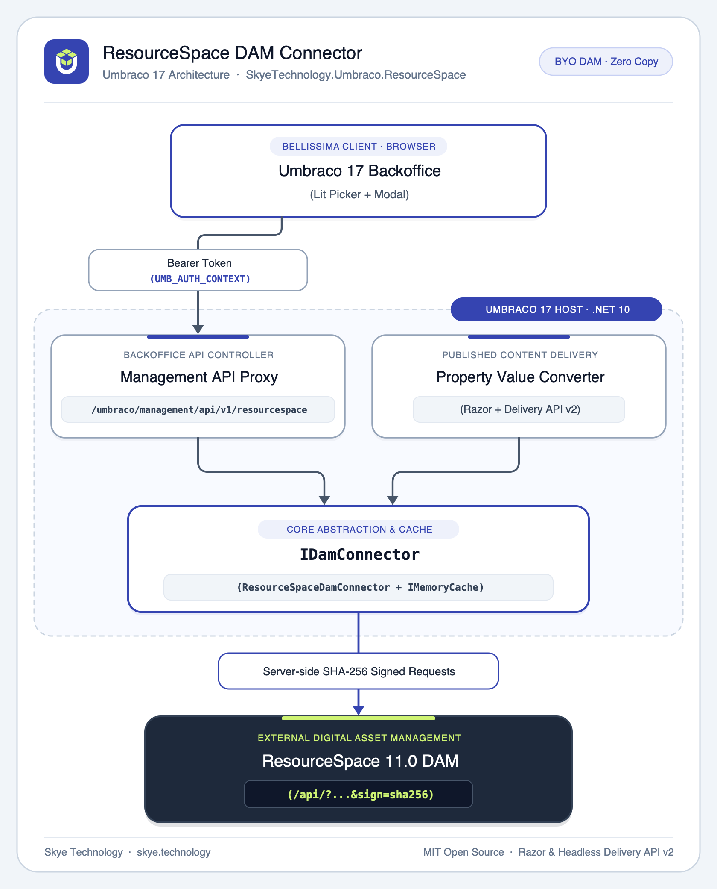

# SkyeTechnology.Umbraco.ResourceSpace

Bring Your Own DAM to **Umbraco 17+**: search, preview, and pick **ResourceSpace** assets directly in the Bellissima backoffice (`@skye-technology/umbraco-resourcespace-client`) and deliver responsive renditions to **Razor views** and the **Content Delivery API v2** without copying files into `wwwroot/media`.

Built and maintained by **[Skye Technology](https://skye.technology)** · **[GitHub Repository & Full Demo Stack](https://github.com/Skye-Technology/ResourceSpace-DAM-Umbraco-Connector)**

## Highlights

- **Server-Side SHA-256 Request Signing:** Proxies all backoffice requests through an authenticated Umbraco Management API controller so ResourceSpace credentials never reach the browser.
- **Native Umbraco 17 (Bellissima) Picker & Slide-Out Modal:** Keyword search, resource-type filters, rendition inspector, live DAM status refresh, and per-page editorial alt-text overrides.
- **Zero Media Duplication:** Stores a compact `DamAssetReference` JSON reference in Umbraco while streaming renditions directly from ResourceSpace / your DAM CDN.
- **Razor + Headless Ready:** Ships with both `IPropertyValueConverter` + `IDeliveryApiPropertyValueConverter` (`PublishedDamAsset`) and a `<dam-image />` responsive `srcset` TagHelper.
- **Governance & Caching Built In:** Separate positive/negative `IMemoryCache` TTLs and automatic suppression when assets are restricted, archived, or deleted in ResourceSpace.

## Architecture Overview



## Installation

```bash
dotnet add package SkyeTechnology.Umbraco.ResourceSpace
```

Services (`AddResourceSpaceDam()` / `IDamConnector`), Management API endpoints (`/umbraco/management/api/v1/resourcespace`), Property Value Converters (`IPropertyValueConverter` + `IDeliveryApiPropertyValueConverter`), and Bellissima backoffice extensions (`<resourcespace-asset-picker>` and `<resourcespace-picker-modal>`) are registered automatically via `ResourceSpaceComposer`.

## Configuration (`appsettings.json` / Environment Variables)

```json
{
  "ResourceSpace": {
    "BaseUrl": "https://dam.example.org",
    "PublicBaseUrl": null,
    "ApiUser": "umbraco_api",
    "ApiKey": "<configure-via-user-secrets-or-key-vault>",
    "DefaultDeliverySize": "scr",
    "PreviewSizes": ["thm", "pre", "scr", "hpr"],
    "TitleFieldId": 8,
    "CaptionFieldId": 18,
    "CreditFieldId": 10,
    "BlockRestrictedAssets": true,
    "AllowedArchiveStates": [0],
    "FallbackImageUrl": null,
    "AssetCacheDuration": "00:10:00",
    "MissingAssetCacheDuration": "00:01:00",
    "HttpTimeout": "00:00:10"
  }
}
```

## Razor Usage

Add the TagHelper to `Views/_ViewImports.cshtml`:

```cshtml
@using SkyeTechnology.Umbraco.ResourceSpace.Models
@addTagHelper *, SkyeTechnology.Umbraco.ResourceSpace
```

Render responsive DAM assets in any view:

```cshtml
@{
    var hero = Model.Value<PublishedDamAsset>("heroAsset");
}
<dam-image asset="@hero"
           size="scr"
           sizes="(max-width: 1080px) 100vw, 1080px"
           loading="eager"
           css-class="hero-image" />
```

## Headless Content Delivery API v2

Properties using the **ResourceSpace - Asset Picker** Data Editor automatically serialize as structured `PublishedDamAsset` JSON payloads on `/umbraco/delivery/api/v2/content` (including `resourceId`, `url`, `previewUrl`, `srcSet`, `altText`, `width`, `height`, `credit`, `isAvailable`, and `renditions`).

## License

MIT — Copyright (c) 2026 [Skye Technology](https://skye.technology).
